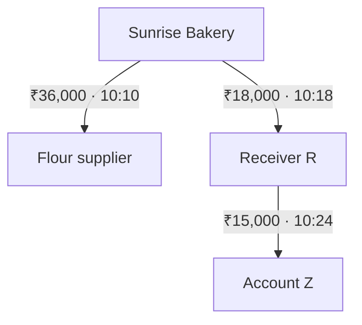

<div align="center">

# MerchantLens
### Follow the money. Understand the purpose.

An investigation workspace that connects merchant payments, downstream transfers and business evidence—so reviewers can see what happened before deciding what to do.

**Interactive 3D graph · Money trails · Evidence-led review**

[Get started](#get-started) · [Explore a case](#explore-your-first-case) · [Technical note](docs/SUPPORTING_NOTE.md) · [Video walkthrough](DEMO_SCRIPT.md)

</div>

---

## A bakery can sell cakes. What else is it collecting money for?

Two customers pay the same bakery ₹500. One buys a cake. The other pays through an unrelated betting checkout.

The merchant identity is genuine. The amounts look ordinary. **The difference is in the purpose and the evidence behind each payment.**

MerchantLens brings those relationships into one workspace. It also considers the other side of the problem: a genuine Diwali sales surge should not be treated as fraud just because payment volume increased.

> **Current status:** working local prototype with synthetic scenarios. Live payment feeds, AWS services and trained ML inference are not connected.

## What you can do

| Workspace | What it helps you understand |
| :--- | :--- |
| **Money trail** | Where funds move, how much is transferred, when it happens and where visibility ends. |
| **3D investigation graph** | How customers, checkouts, merchants, evidence and receivers are connected. |
| **Transaction explorer** | Find sample payments and inspect their supporting context. |
| **Evidence timeline** | Review the sequence of observations and available records. |
| **Human review** | Request clarification, inspect a simulated reply and record a reasoned decision. |
| **Impact preview** | Compare a checkout-level response with the scope of a whole-merchant response. |
| **Case exports** | Save scoped evidence, reasoning and history as JSON or printable HTML. |

### Follow a transfer—not just a risk score

The sample money trail contains these observed movements:



The supplier payment has a matching invoice. Receiver R forwards ₹15,000 six minutes after receiving ₹18,000, but the purpose remains unresolved. Account Z is the last observed receiver.

**A sequence is not proof of purpose.** Money mixes with an account's existing balance; these transfers do not establish which customer's payment funded a later transaction.

## Get started

You need **Node.js 22 or newer**, npm and Git. No cloud credentials or model keys are required.

```bash
git clone https://github.com/petrolhead-pj/merchantlens.git
cd merchantlens
npm run setup
npm run dev
```

Open the local address printed in your terminal—normally **http://localhost:5173**. Access to this private repository is required to clone it.

Already have the project? Stop the development server, then run:

```bash
git pull origin main
npm run setup
npm run dev
```

## Explore your first case

1. **Choose a scenario.** Start with the mixed-purpose merchant.
2. **Read “Where did the money go?”** Compare opening balance, collections, visible outflows and the resulting balance.
3. **Move through time.** Adjust the event-time slider to reveal transfers as they occur.
4. **Follow a receiver.** Select Receiver R, inspect the onward transfer, then follow Account Z to the end of the observed trail.
5. **Inspect the evidence.** Select a recipient or graph node to see its context. Distinguish documented business activity from missing information.
6. **Review the case.** Enter your reasoning, request clarification where needed and record an available outcome.
7. **Export your work.** Download JSON or a printable report. Open the HTML report and choose **Print → Save as PDF**.

There is no countdown and no automatic page navigation. Explore at your own pace.

### Three cases, three different responses

| Scenario | What you see | Review approach |
| :--- | :--- | :--- |
| **Mixed-purpose merchant** | A checkout observation links a subset of payments to activity outside the bakery profile. | Request clarification and escalate the mismatch with reasons. Clearance is unavailable in this scenario. |
| **Diwali sales surge** | Higher volume supported by campaign, order and delivery evidence. | Review the evidence, complete the attestation and record reasons before clearing. |
| **Incomplete evidence** | Payments are visible, but independent checkout-purpose evidence is missing. | Keep the purpose unresolved and request more information. Escalation is not a fraud verdict. |

## Using the graph

| Control | Action |
| :--- | :--- |
| **Drag** | Rotate the 3D view |
| **Right-drag** | Pan across the network |
| **Scroll** | Zoom in or out |
| **Select a node** | Inspect its evidence |
| **Camera presets** | Switch between perspective and front view |
| **Auto orbit** | Turn on a slow camera rotation |
| **Focus / reset** | Expand the graph or return to its starting view |

The 3D view uses WebGL. If WebGL is unavailable, the app provides a labelled SVG compatibility view.

## Review decisions that keep their context

A decision belongs to a particular merchant, payment session, time interval and evidence set.

- Clearance requires the supported seasonal scenario, available checkout evidence, reviewer attestation and written reasoning.
- Escalation requires written reasoning.
- Changing the scenario or checkout coverage resets attestation.
- History and exports are scoped to the selected scenario; an outdated clearance is not treated as applicable.
- Notes, decisions and history persist in **this browser's local storage**. Attestation must be checked again after reloading.

Local storage is not a shared case database. Exported reports are unsigned records, not tamper-proof audit evidence. The prototype does not block payments.

## Under the hood

| Layer | Implementation |
| :--- | :--- |
| **Interface** | React, Vite, CSS and Lucide icons |
| **Graph rendering** | Three.js, React Three Fiber and Drei |
| **Tracing** | Time-ordered traversal with hop limits and cycle stopping |
| **Review state** | Browser-local persistence and explicit decision gates |
| **Backend scaffold** | Read-only Node.js API for demo metadata |
| **Validation** | Node test runner and Vite production build |

### Repository guide

| Path | What's inside |
| :--- | :--- |
| [`frontend/`](frontend/) | Application, graph, money trail and review interface |
| [`backend/`](backend/) | Demo API and automated tests |
| [`docs/SUPPORTING_NOTE.md`](docs/SUPPORTING_NOTE.md) | Technical approach, review safeguards, validation and pilot criteria |
| [`DEMO_SCRIPT.md`](DEMO_SCRIPT.md) | Recording plan; timing suggestions are outside the app |

### Useful commands

Run these from the repository root.

| Command | Purpose |
| :--- | :--- |
| `npm run setup` | Install frontend dependencies from the lockfile |
| `npm run dev` | Start the frontend |
| `npm test` | Run tracing, review-policy, export and API tests |
| `npm run build` | Create a production frontend build |
| `npm run preview` | Preview that build locally |
| `npm run backend` | Start the optional metadata API on port 3001 |

The frontend works independently of the backend scaffold. The API exposes `/api/health`, `/api/scenarios` and `/api/capabilities`.

## What's implemented—and what's next

**Available today:** interactive investigation, sample account-level tracing, evidence coverage controls, scenario-specific review safeguards, local persistence and case exports.

**Proposed production direction:** authorized data integrations through API Gateway and Lambda; queued event processing; Neptune for graph relationships; DynamoDB for case state; S3 for evidence; and EventBridge Scheduler for reconciliation and baseline refreshes.

XGBoost and CatBoost are candidate models for later evaluation. The current scores are illustrative values, not trained predictions. A pilot also needs authenticated access, trustworthy evidence mapping, secure shared storage, validated labels and measured performance.

See the [technical and validation note](docs/SUPPORTING_NOTE.md) for implementation boundaries and manual acceptance checks.

<details>
<summary><strong>Troubleshooting</strong></summary>

### A module import error appears after an update

Stop Vite, pull the latest changes and restart it. The Windows filename-resolution fix uses distinct filenames and explicit imports:

- `MoneyTrail.jsx` — React component
- `money-trail-data.js` — tracing utilities and sample transfers

### The graph opens in compatibility view

The browser could not provide a WebGL context. The SVG view remains available; use a browser with working graphics acceleration for the 3D experience.

### My notes are missing on another device

Review state is stored in the browser where you created it. Export the case to retain a portable copy.

### The production build warns about bundle size

The 3D dependencies produce a large JavaScript bundle. A warning is not a failed build; check loading performance on the device you plan to use.

</details>

---

Built for **The Bakery That Takes Bets · Follow The Money, IIM Bangalore**.

**Team:** Shreyas Naik · Paarth Jain · Anshul Vaibhav  
**Repository maintainer:** Paarth Jain
