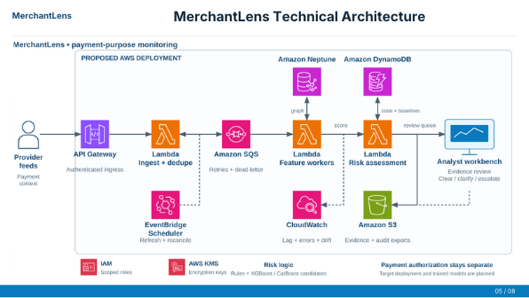

<div align="center">

# MerchantLens
### Follow the money. Understand the purpose.

An investigation workspace that connects merchant payments, downstream transfers and business evidence—so reviewers can see what happened before deciding what to do.

**Interactive 3D graph · Money trails · Evidence-led review**

[Get started](#get-started) · [Architecture](#aws-architecture) · [Feasibility](#feasibility-and-pilot-plan) · [Technical note](docs/SUPPORTING_NOTE.md) · [Video walkthrough](DEMO_SCRIPT.md)

</div>

---

## A bakery can sell cakes. What else is it collecting money for?

Two customers pay the same bakery ₹500. One buys a cake. The other pays through an unrelated betting checkout.

The merchant identity is genuine. The amounts look ordinary. **The difference is in the purpose and the evidence behind each payment.**

MerchantLens brings those relationships into one workspace. It also considers the other side of the problem: a genuine Diwali sales surge should not be treated as fraud just because payment volume increased.

> **Current status:** working local prototype with synthetic scenarios. Live payment feeds, AWS services and trained ML inference are not connected.

## What you can do

| Workspace | What it helps you understand |
| :--- | :--- |
| **Money trail** | Where funds move, how much is transferred, when it happens and where visibility ends. |
| **3D investigation graph** | How customers, checkouts, merchants, evidence and receivers are connected. |
| **Transaction explorer** | Find sample payments and inspect their supporting context. |
| **Evidence timeline** | Review the sequence of observations and available records. |
| **Human review** | Request clarification, inspect a simulated reply and record a reasoned decision. |
| **Impact preview** | Compare a checkout-level response with the scope of a whole-merchant response. |
| **Case exports** | Save scoped evidence, reasoning and history as JSON or printable HTML. |

## AWS architecture

[](https://www.canva.com/design/DAHatghldpQ/magWQTHUHb5z6UFntpuEvw/edit)

*From slide 5 of our presentation. Click to open the full-size Canva deck. This is the proposed deployment; the current app runs locally.*

### How the system would work

| Stage | Services and responsibility | Purpose |
| :--- | :--- | :--- |
| **Receive** | API Gateway and Lambda validate authorized provider events and deduplicate IDs. | Keep malformed or repeated events out of the assessment. |
| **Buffer** | Amazon SQS provides buffering, retries and dead-letter handling. | Absorb bursts and isolate worker failures from payment approval. |
| **Build context** | Lambda feature workers use Neptune for typed, timestamped relationships and DynamoDB for merchant state and baselines. | Connect payment behavior to business context and observed relationships. |
| **Assess** | Risk workers combine rules and baselines with candidate XGBoost/CatBoost models once validated. | Produce reasons, confidence, evidence coverage and a versioned assessment. |
| **Review** | Analysts inspect evidence, request clarification and choose a scoped outcome. S3 holds evidence and audit exports. | Keep decisions tied to the merchant, session and event interval. |
| **Reconcile** | EventBridge Scheduler triggers refresh and reconciliation; CloudWatch monitors processing lag and failures. | Handle late data and make operational problems visible. |

IAM roles, KMS encryption, tokenized identifiers and retention rules are planned production controls. Model drift monitoring and evidence-integrity verification also require implementation.

**Payment authorization stays separate.** Monitoring is asynchronous. A model score does not execute a restriction; any production intervention needs an authorized risk owner and provider-supported scope.

## Get started

### 1. Install the prerequisites

Install **Node.js 22 or newer** (npm is included) and **Git**, then open Terminal or PowerShell.

### 2. Download the project

```bash
git clone https://github.com/petrolhead-pj/merchantlens.git
cd merchantlens
```

### 3. Install dependencies

```bash
npm run setup
```

Wait for the installation to finish.

### 4. Start the app

```bash
npm run dev
```

Open the **Local** URL shown in the terminal—usually **http://localhost:5173**.

You're ready to explore MerchantLens. Keep the terminal running while using the app; press **Ctrl+C** to stop it.

> The frontend runs on its own. You don't need to start the backend or configure AWS credentials or API keys.

## Explore your first case

1. **Choose a scenario.** Start with the mixed-purpose merchant.
2. **Read “Where did the money go?”** Compare opening balance, collections, visible outflows and the resulting balance.
3. **Move through time.** Adjust the event-time slider to reveal transfers as they occur.
4. **Follow a receiver.** Select Receiver R, inspect the onward transfer, then follow Account Z to the end of the observed trail.
5. **Inspect the evidence.** Select a recipient or graph node to see its context. Distinguish documented business activity from missing information.
6. **Review the case.** Enter your reasoning, request clarification where needed and record an available outcome.
7. **Export your work.** Download JSON or a printable report. Open the HTML report and choose **Print → Save as PDF**.

There is no countdown and no automatic page navigation. Explore at your own pace.

### Three cases, three different responses

| Scenario | What you see | Review approach |
| :--- | :--- | :--- |
| **Mixed-purpose merchant** | A checkout observation links a subset of payments to activity outside the bakery profile. | Request clarification and escalate the mismatch with reasons. Clearance is unavailable in this scenario. |
| **Diwali sales surge** | Higher volume supported by campaign, order and delivery evidence. | Review the evidence, complete the attestation and record reasons before clearing. |
| **Incomplete evidence** | Payments are visible, but independent checkout-purpose evidence is missing. | Keep the purpose unresolved and request more information. Escalation is not a fraud verdict. |

## Using the graph

| Control | Action |
| :--- | :--- |
| **Drag** | Rotate the 3D view |
| **Right-drag** | Pan across the network |
| **Scroll** | Zoom in or out |
| **Select a node** | Inspect its evidence |
| **Camera presets** | Switch between perspective and front view |
| **Auto orbit** | Turn on a slow camera rotation |
| **Focus / reset** | Expand the graph or return to its starting view |

The 3D view uses WebGL. If WebGL is unavailable, the app provides a labelled SVG compatibility view.

## Review decisions that keep their context

A decision belongs to a particular merchant, payment session, time interval and evidence set.

- Clearance requires the supported seasonal scenario, available checkout evidence, reviewer attestation and written reasoning.
- Escalation requires written reasoning.
- Changing the scenario or checkout coverage resets attestation.
- History and exports are scoped to the selected scenario; an outdated clearance is not treated as applicable.
- Notes, decisions and history persist in **this browser's local storage**. Attestation must be checked again after reloading.

Local storage is not a shared case database. Exported reports are unsigned records, not tamper-proof audit evidence. The prototype does not block payments.

## Under the hood

| Layer | Implementation |
| :--- | :--- |
| **Interface** | React, Vite, CSS and Lucide icons |
| **Graph rendering** | Three.js, React Three Fiber and Drei |
| **Tracing** | Time-ordered traversal with hop limits and cycle stopping |
| **Review state** | Browser-local persistence and explicit decision gates |
| **Backend scaffold** | Read-only Node.js API for demo metadata |
| **Validation** | Node test runner and Vite production build |

### Repository guide

| Path | What's inside |
| :--- | :--- |
| [`frontend/`](frontend/) | Application, graph, money trail and review interface |
| [`backend/`](backend/) | Demo API and automated tests |
| [`docs/SUPPORTING_NOTE.md`](docs/SUPPORTING_NOTE.md) | Technical approach, review safeguards, validation and pilot criteria |
| [`DEMO_SCRIPT.md`](DEMO_SCRIPT.md) | Recording plan; timing suggestions are outside the app |

### Useful commands

Run these from the repository root.

| Command | Purpose |
| :--- | :--- |
| `npm run setup` | Install frontend dependencies from the lockfile |
| `npm run dev` | Start the frontend |
| `npm test` | Run tracing, review-policy, export and API tests |
| `npm run build` | Create a production frontend build |
| `npm run preview` | Preview that build locally |
| `npm run backend` | Start the optional metadata API on port 3001 |

The frontend works independently of the backend scaffold. The API exposes `/api/health`, `/api/scenarios` and `/api/capabilities`.

## Feasibility and pilot plan

**Intended user:** a payment-provider risk analyst investigating whether current merchant activity matches the declared business.

Begin with authorized historical replay, then run a shadow pilot alongside existing systems. This lets analysts assess value before any payment decision is affected.

### Why this is practical

| Design choice | Benefit | Dependency or trade-off |
| :--- | :--- | :--- |
| **Start with rules and baselines** | Explainable behavior before enough reviewed labels exist for ML. | Thresholds and peer groups need validation; volume alone is not a verdict. |
| **Bound graph exploration** | Time windows, hop limits and cycle stopping keep the investigation focused. | The prototype has traversal bounds; production needs query budgets and load testing. |
| **Keep missing evidence explicit** | Request clarification instead of inventing the recipient's activity. | Coverage depends on authorized feeds and reliable merchant/session mapping. |
| **Separate ingestion and analysis** | Queue-based processing supports burst handling and retries. | Idempotency, ordering and late-event replay need production verification. |
| **Compare intervention scope** | Show the legitimate activity potentially affected by a broad response. | Actual restriction granularity depends on the payment provider. |
| **Track cost per reviewed case** | Connect infrastructure and analyst effort to business value. | No production cost, throughput or savings benchmark is established yet. |

### Data required

The basic event record needs a payment ID, merchant ID, timestamp, amount and session mapping. Merchant profiles, checkout observations, orders and fulfilment records add purpose evidence. Downstream tracing additionally requires authorized transfer visibility.

There is no universal minimum history or training-set size. Establish baseline coverage by merchant segment, assess label quality, and evaluate on separate merchants and later time periods. Exclude graph edges and evidence unavailable at the scoring cutoff.

### Delivery milestones

| Phase | Deliverable | Gate to progress |
| :--- | :--- | :--- |
| **Local prototype** | Interactive graph, money trails, review gates and case exports. | Reproducible setup, automated tests and device-level manual checks. |
| **Controlled evaluation** | Historical replay; compare rules with candidate models. | Reliable mappings, adjudicated labels, no future-data leakage and equal analyst capacity. |
| **Authorized shadow pilot** | Cases delivered to partner analysts without automated intervention. | Access controls, provenance, retention, replay correctness and operational monitoring. |
| **Production consideration** | Shared authenticated case storage and provider-approved response integration. | Measured quality, genuine-merchant impact, reliability and operating cost. |

Measure **verified mismatch precision/recall, unnecessary interventions, analyst review time, evidence coverage/freshness and cost per reviewed merchant**. Compare systems at the same review budget. These are evaluation criteria, not claimed results.

## Implementation status and validation

| Available today | Further implementation required |
| :--- | :--- |
| Interactive 3D graph and SVG fallback | Live payment, checkout and bank integrations |
| Time-filtered account tracing and balance reconciliation | AWS deployment and production event workers |
| Scenario-specific review gates and browser-local history | Authenticated shared case storage |
| JSON and printable HTML reports | Signed evidence manifests and verified provenance |
| Read-only metadata API and automated tests | Trained, calibrated XGBoost/CatBoost inference |

Tests cover temporal traversal, cycles, hop bounds, balance reconciliation, review gates, stale outcomes, scenario isolation, HTML escaping and the read-only API. Run `npm test` and `npm run build`; a successful build does not replace checking the interface on the recording device.

The data and displayed scores are synthetic fixtures. Account-level sequence cannot establish which customer's payment funded a later transfer through a mixed balance. Unknown recipients remain unresolved without supporting evidence.

See the [technical and validation note](docs/SUPPORTING_NOTE.md) for acceptance checks, export semantics and pilot prerequisites.

<details>
<summary><strong>Troubleshooting</strong></summary>

### A module import error appears after an update

Stop Vite, pull the latest changes and restart it. The Windows filename-resolution fix uses distinct filenames and explicit imports:

- `MoneyTrail.jsx` — React component
- `money-trail-data.js` — tracing utilities and sample transfers

### The graph opens in compatibility view

The browser could not provide a WebGL context. The SVG view remains available; use a browser with working graphics acceleration for the 3D experience.

### My notes are missing on another device

Review state is stored in the browser where you created it. Export the case to retain a portable copy.

### The production build warns about bundle size

The 3D dependencies produce a large JavaScript bundle. A warning is not a failed build; check loading performance on the device you plan to use.

</details>

---

Built for **The Bakery That Takes Bets · Follow The Money, IIM Bangalore**.

**Team:** Shreyas Naik · Paarth Jain · Anshul Vaibhav  
**Repository maintainer:** Paarth Jain
